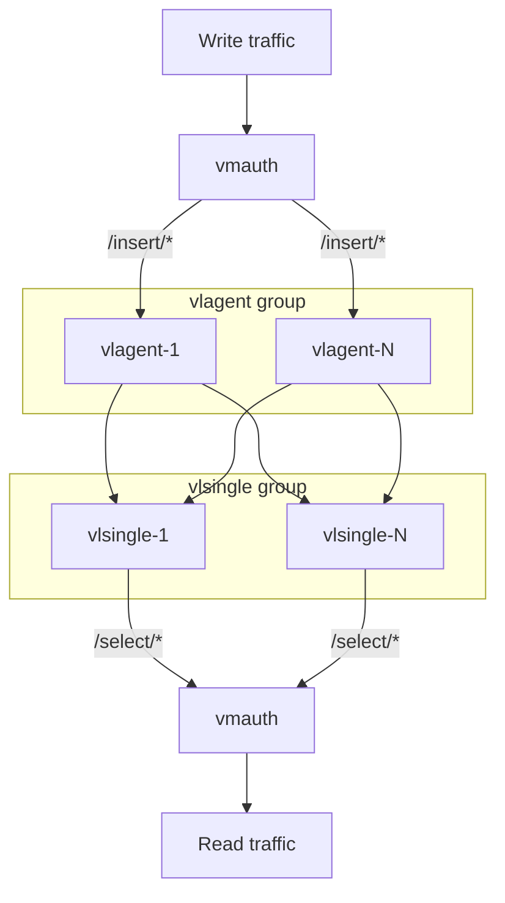
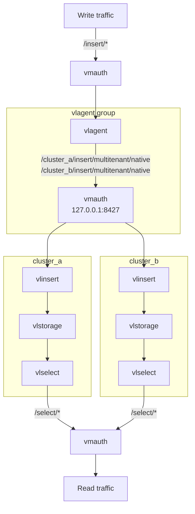

# VictoriaLogs High Availability Deployment

A single VictoriaLogs instance or cluster does not replicate data, so queries fail or return incomplete results while a storage node is down.
High availability is built by writing a copy of every log entry into independent VictoriaLogs installations, as described in the [VictoriaLogs HA docs](https://docs.victoriametrics.com/victorialogs/cluster/#high-availability):

- [vlagent](https://docs.victoriametrics.com/victorialogs/vlagent/) accepts logs and replicates them to every installation. It buffers logs on disk for an installation which is unavailable and sends them once it is back.
- [vmauth](https://docs.victoriametrics.com/victoriametrics/vmauth/) is the single entrypoint. It routes `/insert/*` requests to vlagent and `/select/*` requests to the first available installation.

Send logs to and query logs from `http://<any-vmauth-node>:8427/`.

Two examples are available:

| Playbook | Inventory | Replicated unit |
|----------|-----------|-----------------|
| [playbooks/vlsingle-ha.yml](../playbooks/vlsingle-ha.yml) | [vlsingle-ha-inventory](../inventory_example/vlsingle-ha-inventory) | single-node VictoriaLogs instances |
| [playbooks/vlcluster-ha.yml](../playbooks/vlcluster-ha.yml) | [vlcluster-ha-inventory](../inventory_example/vlcluster-ha-inventory) | VictoriaLogs clusters |

Both playbooks store the vlagent buffer in `/var/lib/vlagent` via `vlagent_tmp_data_path`, so the buffered logs survive vlagent restarts.

## Single-node instances

Every host of the `vlsingle` group stores a complete copy of the logs. Hosts of the `vlagent` and `vmauth` groups can be dedicated hosts or the same hosts as `vlsingle`, since all three services listen on different ports.

## Clusters

Every cluster has its own vlstorage, vlinsert and vlselect nodes, deployed the same way as in the [cluster deployment](./victorialogs-cluster.md), and stores a complete copy of the logs.

The inventory describes a cluster with the following conventions:

- the `vl_cluster` variable holds the cluster name for every host of the cluster
- the `<vl_cluster>_vlstorage` and `<vl_cluster>_vlinsert` groups list the vlstorage and vlinsert nodes of the cluster
- the `vlstorage`, `vlinsert` and `vlselect` groups contain the nodes of all the clusters

To add a cluster, add its groups and the `vl_cluster` variable to the inventory. The playbook does not need changes.

Hosts of the `vlagent` group accept logs from vmauth and replicate them to every cluster. vlagent has a single `-remoteWrite.url` per cluster, so every `vlagent` host also runs its own vmauth, which listens on `127.0.0.1:8427` only. vlagent sends every replication stream to it at `/<vl_cluster>/insert/multitenant/native`, and it balances the stream among the vlinsert nodes of that cluster.

Hosts of the `vmauth` group are the entrypoint. vmauth there balances `/insert/*` requests among the `vlagent` hosts and does not serve the per-cluster paths, so clients cannot write into a single cluster and bypass replication. The `vlagent` and `vmauth` groups must not share hosts, since both run vmauth with a different configuration.

vmauth sends queries to the first vlselect node in the list and switches to the next one when the node is unreachable or responds with `502` or `503`. vlselect responds with `502` when some of the vlstorage nodes of its cluster are unavailable, so such a cluster stops serving queries until it is complete again.

## Recovery after an outage

vmauth routes queries back to a recovered installation as soon as it responds, while vlagent may still be sending the buffered logs to it. Queries can miss these logs until the buffer is drained.
To avoid this, keep the recovered installation out of the query path (for example, by starting its vlselect nodes later) until the `vlagent_remotewrite_pending_data_bytes` metric of every vlagent drops to zero.

## Local testing

Both examples have a [molecule](../playbooks/molecule) scenario, which deploys the playbook into docker containers, sends a log entry through vmauth and checks that it reaches every installation:

- `make molecule-converge-vlsingle-ha-integration`
- `make molecule-converge-vlcluster-ha-integration`

Use the matching `molecule-destroy-*` targets to remove the containers.
