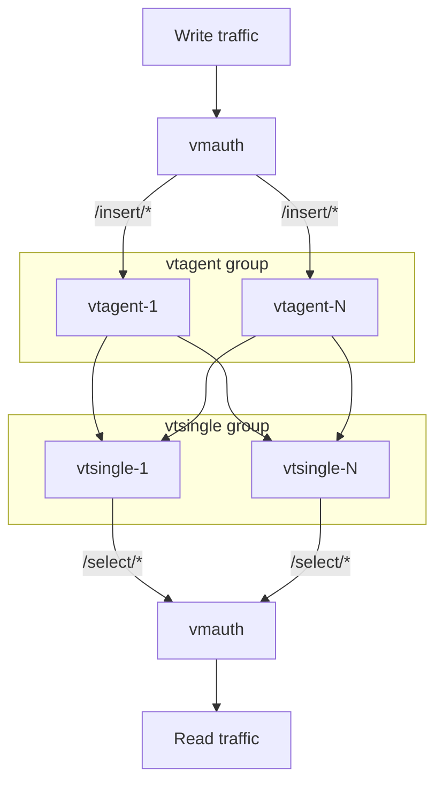
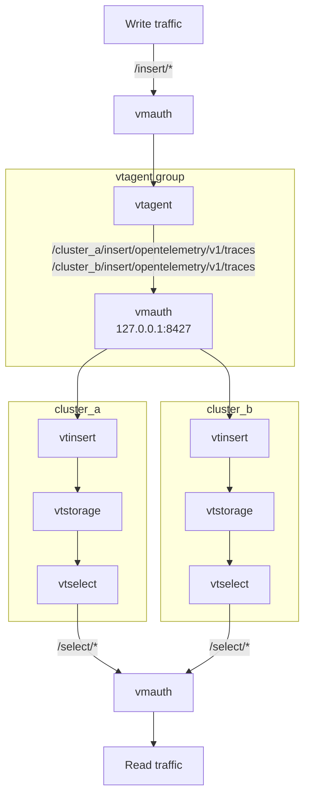

# VictoriaTraces High Availability Deployment

A single VictoriaTraces instance or cluster does not replicate data, so queries fail or return incomplete results while a storage node is down.
High availability is built by writing a copy of every span into independent VictoriaTraces installations, as described in the [VictoriaTraces HA docs](https://docs.victoriametrics.com/victoriatraces/cluster/#high-availability):

- [vtagent](https://docs.victoriametrics.com/victoriatraces/vtagent/) accepts spans and replicates them to every installation. It buffers spans on disk for an installation which is unavailable and sends them once it is back.
- [vmauth](https://docs.victoriametrics.com/victoriametrics/vmauth/) is the single entrypoint. It routes `/insert/*` requests to vtagent and `/select/*` requests to the first available installation.

Send spans to and query traces from `http://<any-vmauth-node>:8427/`.

Two examples are available:

| Playbook | Inventory | Replicated unit |
|----------|-----------|-----------------|
| [playbooks/vtsingle-ha.yml](../playbooks/vtsingle-ha.yml) | [vtsingle-ha-inventory](../inventory_example/vtsingle-ha-inventory) | single-node VictoriaTraces instances |
| [playbooks/vtcluster-ha.yml](../playbooks/vtcluster-ha.yml) | [vtcluster-ha-inventory](../inventory_example/vtcluster-ha-inventory) | VictoriaTraces clusters |

Both playbooks store the vtagent buffer in `/var/lib/vtagent` via `vtagent_tmp_data_path`, so the buffered spans survive vtagent restarts.

## Single-node instances

Every host of the `vtsingle` group stores a complete copy of the spans. Hosts of the `vtagent` and `vmauth` groups can be dedicated hosts or the same hosts as `vtsingle`, since all three services listen on different ports.

## Clusters

Every cluster has its own vtstorage, vtinsert and vtselect nodes, deployed the same way as in the [cluster deployment](./victoriatraces-cluster.md), and stores a complete copy of the spans.

The inventory describes a cluster with the following conventions:

- the `vt_cluster` variable holds the cluster name for every host of the cluster
- the `<vt_cluster>_vtstorage` and `<vt_cluster>_vtinsert` groups list the vtstorage and vtinsert nodes of the cluster
- the `vtstorage`, `vtinsert` and `vtselect` groups contain the nodes of all the clusters

To add a cluster, add its groups and the `vt_cluster` variable to the inventory. The playbook does not need changes.

Hosts of the `vtagent` group accept spans from vmauth and replicate them to every cluster. vtagent has a single `-remoteWrite.url` per cluster, so every `vtagent` host also runs its own vmauth, which listens on `127.0.0.1:8427` only. vtagent sends every replication stream to it at `/<vt_cluster>/insert/opentelemetry/v1/traces`, and it balances the stream among the vtinsert nodes of that cluster.

Hosts of the `vmauth` group are the entrypoint. vmauth there balances `/insert/*` requests among the `vtagent` hosts and does not serve the per-cluster paths, so clients cannot write into a single cluster and bypass replication. The `vtagent` and `vmauth` groups must not share hosts, since both run vmauth with a different configuration.

vmauth sends queries to the first vtselect node in the list and switches to the next one when the node is unreachable or responds with `502` or `503`. vtselect responds with an error when some of the vtstorage nodes of its cluster are unavailable, so such a cluster stops serving queries until it is complete again.

## Recovery after an outage

vmauth routes queries back to a recovered installation as soon as it responds, while vtagent may still be sending the buffered spans to it. Queries can miss these spans until the buffer is drained.
To avoid this, keep the recovered installation out of the query path (for example, by starting its vtselect nodes later) until every vtagent has drained its buffer.

## Local testing

Both examples have a [molecule](../playbooks/molecule) scenario, which deploys the playbook into docker containers, sends a span through vmauth and checks that it reaches every installation:

- `make molecule-converge-vtsingle-ha-integration`
- `make molecule-converge-vtcluster-ha-integration`

Use the matching `molecule-destroy-*` targets to remove the containers.
